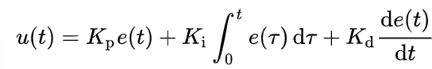
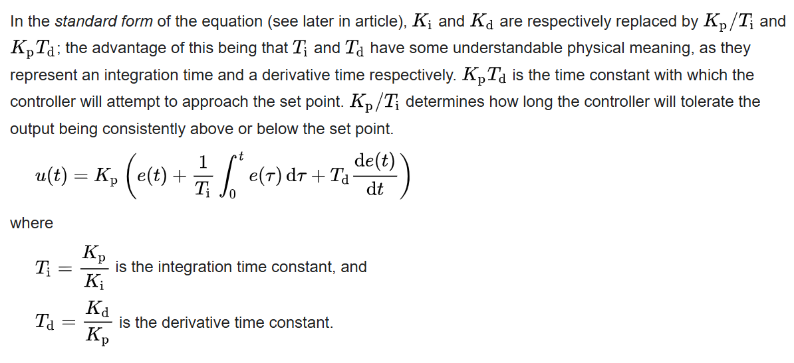

PID control

- Proportional
- integral
- derivative

Corrective actions are automatically applied to bring the PV (process variable) to the same value as the SP (setpoint (target value))

- Proportional applies a corrective actionwhich is directly proportional to the magnitude of the error
- integral component consdiers teh cumulative sum of the past errors to address any residual steady stae errors that persist over time, eliminating lingering discrepancies.
- Derivative component predicts future errors that persist over time and eliminates lingering discrepancies which help to mitigate overshoot and enhance system stability.

PID signal is used to control actuators through voltage,current, modulation methods. It improves atoamtion and reduces the likelihood of human errors.

```
SP = r(t)
PV = y(t)

e(t) = r(t) - y(t) --this measures the error
```

## Tuning

The balance of the effects is achieved by loop tuning to produce the optimal contol function. The tuning constants must be derived for each control application and depends on the response characteristics of the physical system.

## Control action

This is a mathematical model and pracitcal loop used BOTH as a direct cntrol action for all the terms (increasing positive error results in an increasing positive contol output correction)



### Standard form of the control function:


